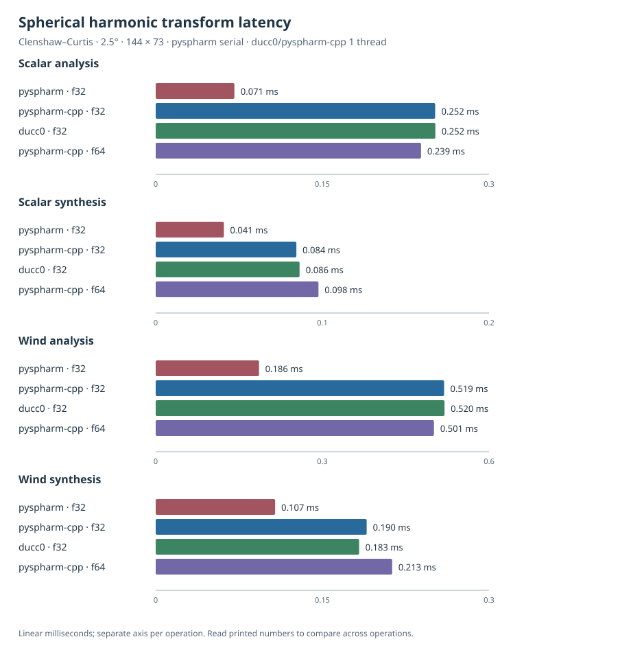
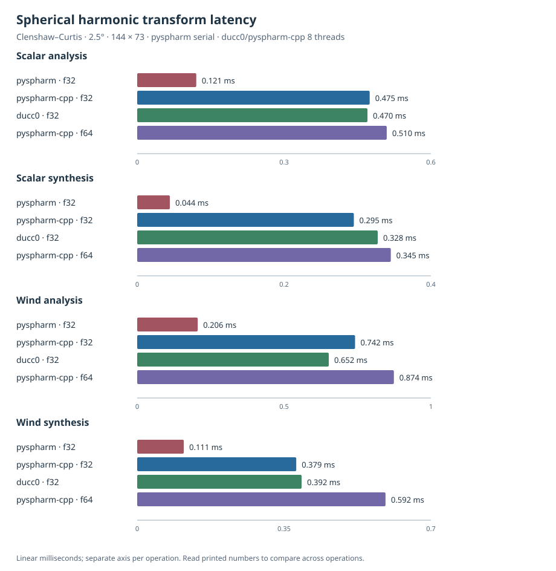
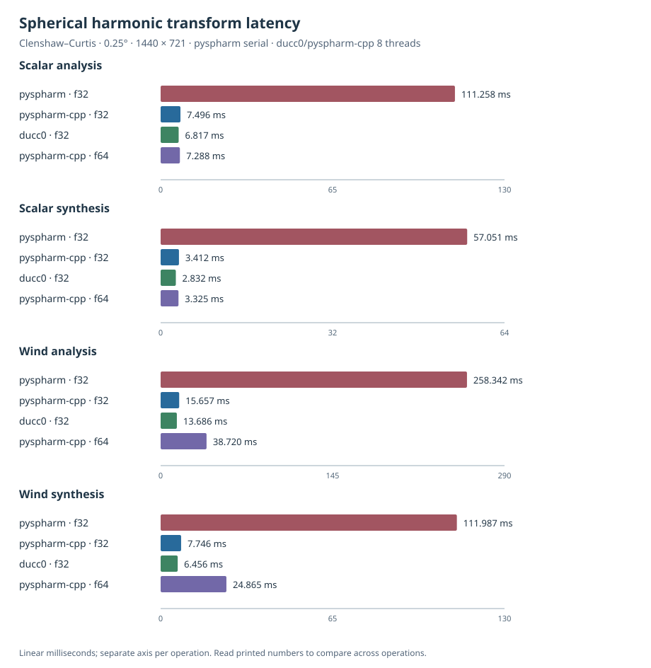
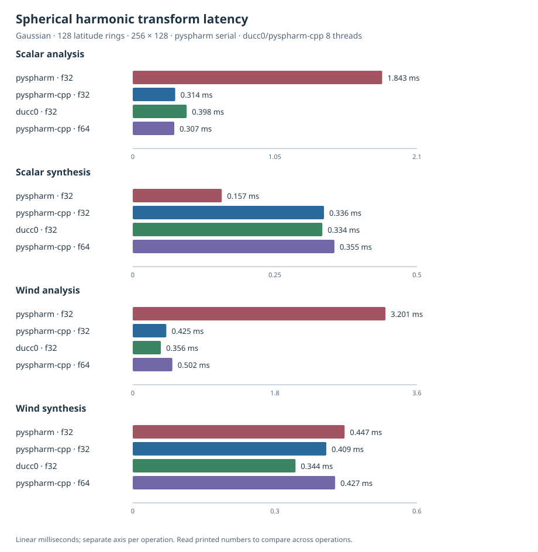
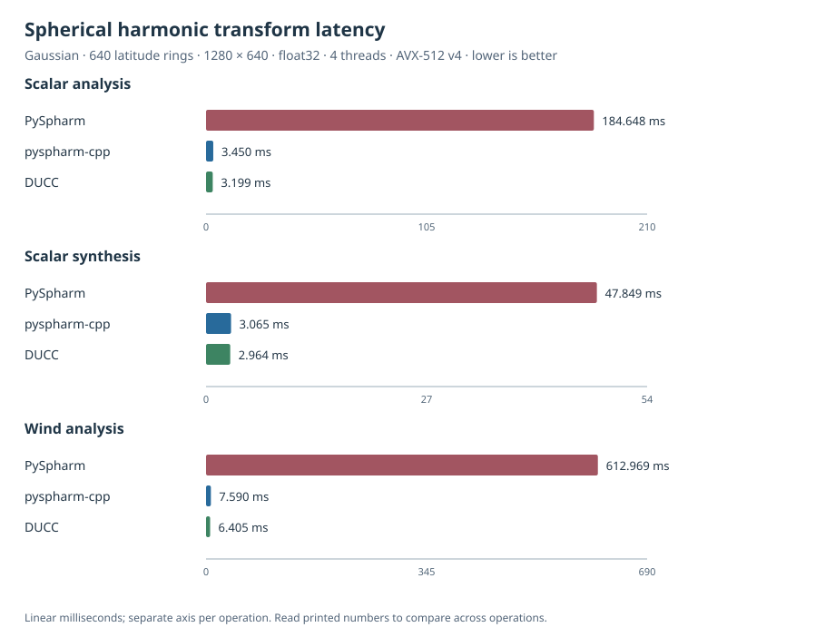

# Benchmarks

These charts compare scalar and wind spherical harmonic transform (SHT)
analysis and synthesis latencies for PySpharm `float32`, `ducc0` `float32`, and
`pyspharm-cpp` `float32` and `float64`. Each operation has its own zero-based linear
time scale; compare bar lengths within an operation and use the printed values
across operations. Smaller is better. Speedup is the PySpharm median divided
by the `pyspharm-cpp` `float32` median.

The measurements were collected on 2026-10-25 on an AMD Ryzen 9 5900XT
16-Core Processor. Linux reported 16 logical CPUs; process affinity exposed
CPUs 0–15. The benchmark found 16 effective CPUs. No cgroup CPU quota
interface was available in this WSL2 environment. The OS was Linux
6.6.87.2-microsoft-standard-WSL2 x86-64 with glibc 2.43. The processor exposes
AVX2 but not AVX-512. The `pyspharm-cpp` extension was built in Release mode
with GNU C++ 15.2.0 and CMake 4.4.4 using the `multiarch` profile. The active
SIMD profile was `x86-64-v3`; x86-64-v4 was unavailable and was not benchmarked.

The software versions were CPython 3.14.9, NumPy 2.5.4, PySpharm 1.0.9,
`ducc0` 0.42.0, and `pyspharm-cpp` 0.1.0.dev0. PySpharm was installed
from conda-forge, and `pyspharm-cpp` from the current checkout.

The 2.5° one-thread case uses one DUCC thread; the other four cases use eight
DUCC threads. PySpharm is serial. The main speedup comparison therefore
compares serial PySpharm with eight-thread `ducc0` and `pyspharm-cpp` for those
four cases. The `ducc0` spin-1 transforms form the wind baseline;
`pyspharm-cpp` wind operations also convert between wind fields and spectral
coefficients for relative vorticity and divergence. Each median uses seven
timed repetitions after two warmups without CPU pinning. The p90 is the
nearest-rank 90th percentile, which is the maximum of seven samples. Float64
runs use casts of the same `float32` input fields, and synthesis inputs are
computed before timing. Inputs use NumPy seed 20261024.

The same spectral truncation is used for all backends and operations:
min(nlat - 2, (nlon - 1) // 2) for Clenshaw–Curtis grids and
min(nlat - 1, (nlon - 1) // 2) for Gaussian grids.

## Clenshaw–Curtis · 2.5° · 144 × 73 (one thread)

| Operation | PySpharm f32 | `pyspharm-cpp` f32 | `ducc0` f32 | `pyspharm-cpp` f64 | Speedup vs PySpharm |
| --- | ---: | ---: | ---: | ---: | ---: |
| Scalar analysis | 0.090 ms | 0.254 ms | 0.251 ms | 0.250 ms | 0.36× |
| Scalar synthesis | 0.047 ms | 0.084 ms | 0.096 ms | 0.086 ms | 0.56× |
| Wind analysis | 0.202 ms | 0.536 ms | 0.512 ms | 0.509 ms | 0.38× |
| Wind synthesis | 0.112 ms | 0.190 ms | 0.192 ms | 0.185 ms | 0.59× |

## Clenshaw–Curtis · 2.5° · 144 × 73 (eight threads)

| Operation | PySpharm f32 | `pyspharm-cpp` f32 | `ducc0` f32 | `pyspharm-cpp` f64 | Speedup vs PySpharm |
| --- | ---: | ---: | ---: | ---: | ---: |
| Scalar analysis | 0.121 ms | 0.475 ms | 0.470 ms | 0.510 ms | 0.25× |
| Scalar synthesis | 0.044 ms | 0.295 ms | 0.328 ms | 0.345 ms | 0.15× |
| Wind analysis | 0.206 ms | 0.742 ms | 0.652 ms | 0.874 ms | 0.28× |
| Wind synthesis | 0.111 ms | 0.379 ms | 0.392 ms | 0.592 ms | 0.29× |

## Clenshaw–Curtis · 0.25° · 1440 × 721 (eight threads)

| Operation | PySpharm f32 | `pyspharm-cpp` f32 | `ducc0` f32 | `pyspharm-cpp` f64 | Speedup vs PySpharm |
| --- | ---: | ---: | ---: | ---: | ---: |
| Scalar analysis | 111.258 ms | 7.496 ms | 6.817 ms | 7.288 ms | 14.84× |
| Scalar synthesis | 57.051 ms | 3.412 ms | 2.832 ms | 3.325 ms | 16.72× |
| Wind analysis | 258.342 ms | 15.657 ms | 13.686 ms | 38.720 ms | 16.50× |
| Wind synthesis | 111.987 ms | 7.746 ms | 6.456 ms | 24.865 ms | 14.46× |

## Gaussian · 128 latitude rings · 256 × 128 (eight threads)

| Operation | PySpharm f32 | `pyspharm-cpp` f32 | `ducc0` f32 | `pyspharm-cpp` f64 | Speedup vs PySpharm |
| --- | ---: | ---: | ---: | ---: | ---: |
| Scalar analysis | 1.843 ms | 0.314 ms | 0.398 ms | 0.307 ms | 5.88× |
| Scalar synthesis | 0.157 ms | 0.336 ms | 0.334 ms | 0.355 ms | 0.47× |
| Wind analysis | 3.201 ms | 0.425 ms | 0.356 ms | 0.502 ms | 7.53× |
| Wind synthesis | 0.447 ms | 0.409 ms | 0.344 ms | 0.427 ms | 1.09× |

## Gaussian · 640 latitude rings · 1280 × 640 (eight threads)

| Operation | PySpharm f32 | `pyspharm-cpp` f32 | `ducc0` f32 | `pyspharm-cpp` f64 | Speedup vs PySpharm |
| --- | ---: | ---: | ---: | ---: | ---: |
| Scalar analysis | 139.024 ms | 2.103 ms | 2.411 ms | 2.206 ms | 66.11× |
| Scalar synthesis | 32.081 ms | 2.227 ms | 2.304 ms | 2.682 ms | 14.41× |
| Wind analysis | 339.515 ms | 4.890 ms | 3.389 ms | 28.454 ms | 69.42× |
| Wind synthesis | 67.204 ms | 5.432 ms | 4.558 ms | 7.392 ms | 12.37× |

| Grid case | Largest speedup | Operation |
| --- | ---: | --- |
| Clenshaw–Curtis 144 × 73, one thread | 0.59× | Wind synthesis |
| Clenshaw–Curtis 144 × 73, eight threads | 0.29× | Wind synthesis |
| Clenshaw–Curtis 1440 × 721, eight threads | 16.72× | Scalar synthesis |
| Gaussian 256 × 128, eight threads | 7.53× | Wind analysis |
| Gaussian 1280 × 640, eight threads | 69.42× | Wind analysis |

Across the five cases, `pyspharm-cpp` `float32` was slower than serial PySpharm
for all four operations on the 144 × 73 grid at both thread counts. On the
larger 1440 × 721 and 1280 × 640 grids, `pyspharm-cpp` was faster for all four
operations. The 256 × 128 Gaussian case was mixed: scalar and wind analysis
were faster, wind synthesis was close to parity, and scalar synthesis was
slower. The largest measured ratio was 69.42× for wind analysis on the
1280 × 640 Gaussian grid. These ratios include the difference between serial
PySpharm and eight DUCC threads for the multithreaded cases.

## Legendre and interpolation overloads

The auxiliary benchmark compares repeated scalar calls with one batched call
for four cases: 8 points at `lmax` 16, 64 points at `lmax` 64, 128 points at
`lmax` 256, and 16 points at `lmax` 1024. It used `float32` and `float64`, two
warmups, seven repetitions, and separate processes at one, two, and four
threads on the active `x86-64-v3` profile. Ratios are scalar-call median divided
by batched-call median, summarized as ranges across the four cases. Ratios
above one favor the batched call; ratios below one indicate a slowdown.

| Threads | Operation | Float32 ratio range | Float64 ratio range |
| ---: | --- | ---: | ---: |
| 1 | Legendre | 1.45–5.14× | 0.84–3.54× |
| 1 | Spectral interpolation | 2.41–3.94× | 1.92–2.73× |
| 2 | Legendre | 1.37–6.26× | 1.36–3.62× |
| 2 | Spectral interpolation | 2.43–4.39× | 1.52–3.47× |
| 4 | Legendre | 1.25–8.15× | 2.19–4.96× |
| 4 | Spectral interpolation | 1.89–5.70× | 1.42–5.32× |

The `float64` Legendre ratio of 0.84 at one thread was a slowdown for the
128-point, `lmax`-256 case. Other listed ratios exceeded one. At each thread
count, scalar and batched outputs were compared using tolerances from the
numerical tests. Legendre passed for both precisions and all four cases.
Float64 interpolation passed all four cases. Float32 interpolation exceeded
the existing `rtol=2e-5`, `atol=2e-6` tolerance at all three thread counts for
two of 64 points at `lmax` 64 and one of 128 points at `lmax` 256; the maximum
absolute differences were 4.29e-5 and 4.33e-4, respectively. The `float32`
interpolation ratios are therefore recorded as timing observations, not as
validated equivalent-output speedups.

## Run benchmarks

The committed [measurements.csv](measurements.csv) contains 80 measurements:
five cases × four operations × four timing series (PySpharm `float32`, `ducc0`
`float32`, `pyspharm-cpp` `float32`, and `pyspharm-cpp` `float64`). It records the
thread count, truncation, median, and p90 for every measurement. The benchmark
rejects a requested thread count above the CPUs available from process
affinity and the cgroup CPU quota when that quota is exposed.

Create the conda benchmark environment and install the checkout with the
multiarch build profile:

    conda env create -f .github/conda/pyspharm.yml
    conda run --no-capture-output -n pyspharm-reference python -m pip install \
      --no-build-isolation --no-deps -e . \
      --config-settings=cmake.define.SPHARM_CPP_BUILD_PROFILE=multiarch

Run the four eight-thread cases and the one-thread case in separate Python
processes because DUCC's thread configuration is initialized on its first
numerical call:

    conda run --no-capture-output -n pyspharm-reference python benchmarks/benchmark.py \
      --threads 8 --warmups 2 --repeats 7 --expected-profile x86-64-v3 \
      --output /tmp/sht-eight-thread.csv
    conda run --no-capture-output -n pyspharm-reference python benchmarks/benchmark.py \
      --cases cc-2p5-1t --threads 1 --warmups 2 --repeats 7 \
      --expected-profile x86-64-v3 --output /tmp/sht-one-thread.csv

Combine the measurements and regenerate the five figures:

    {
      head -n 1 /tmp/sht-eight-thread.csv
      tail -n +2 /tmp/sht-eight-thread.csv
      tail -n +2 /tmp/sht-one-thread.csv
    } > benchmarks/measurements.csv
    conda run --no-capture-output -n pyspharm-reference python benchmarks/plot.py \
      --csv benchmarks/measurements.csv --output-dir benchmarks

Add `--print-samples` to a benchmark command to print individual timing samples
when checking measurement variability. For CPU dispatch and affinity
information, the benchmark prints a `BENCHMARK_METADATA` record at startup.

Measure the auxiliary kernels in one, two, and four-thread processes:

    for threads in 1 2 4; do
      conda run --no-capture-output -n pyspharm-reference python \
        benchmarks/benchmark_auxiliary.py --threads "$threads" \
        --warmups 2 --repeats 7 --output "/tmp/auxiliary-$threads.csv"
    done

The figures can also be regenerated directly from the committed CSV:

    conda run --no-capture-output -n pyspharm-reference python benchmarks/plot.py \
      --csv benchmarks/measurements.csv --output-dir benchmarks

The plotter derives thread-count labels from the CSV and checks timing-series
completeness and consistent multithreaded thread counts. Independent numerical
validation is in [tests/parity/](../tests/parity).
