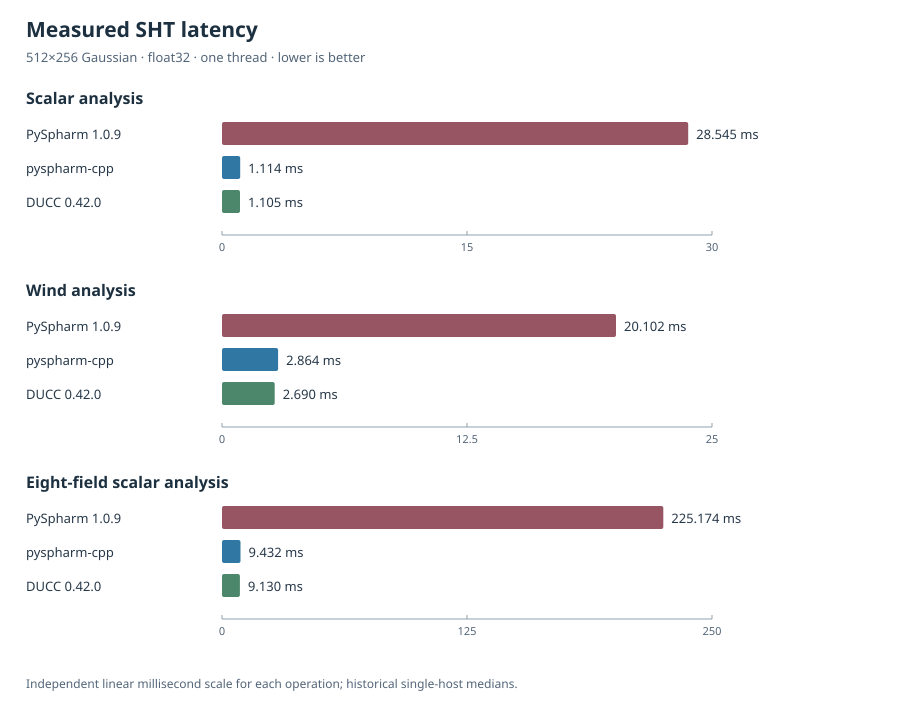

<!-- SPDX-License-Identifier: GPL-2.0-or-later -->

# Benchmarks

The figure compares median elapsed times for three spherical harmonic
operations on a 512 × 256 Gaussian grid, float32, using one DUCC thread.
Each operation has a separate **linear** millisecond axis, starting at zero,
to make the three implementations visible at different time scales.



| Operation | PySpharm 1.0.9 | pyspharm-cpp | DUCC 0.42.0 | Speedup vs PySpharm |
| --- | ---: | ---: | ---: | ---: |
| Scalar analysis | 28.545 ms | 1.114 ms | 1.105 ms | 25.6× |
| Wind analysis | 20.102 ms | 2.864 ms | 2.690 ms | 7.0× |
| Eight-field scalar analysis | 225.174 ms | 9.432 ms | 9.130 ms | 23.9× |

The speedup column compares **pyspharm-cpp with PySpharm**, calculated from
unrounded median times; DUCC is shown as a direct-backend reference.
Measurements used PySpharm 1.0.9, the multiarch `pyspharm-cpp` 0.1.0
wheel, and DUCC 0.42.0 on a Linux x86-64 AVX2 host running CPython
3.15.0rc2. The historical run used three warmups and ten repetitions,
without CPU pinning. Performance depends on the operation, grid, hardware,
build profile, and host load.

## Reproduce

`benchmark.py` measures warmed median and p90 times and exports CSV.
Install `pyspharm-cpp`, `ducc0==0.42.0`, and
`pyspharm-syl==1.2.1` (PySpharm 1.0.9), with a compatible NumPy, in the
benchmark environment.

```sh
DUCC0_NUM_THREADS=1 python benchmarks/benchmark.py \
  --sizes 512x256 --fields 8 --precision float32 \
  --threads 1 --warmups 5 --repeats 25 \
  --output /tmp/pyspharm-benchmark.csv
python benchmarks/plot.py \
  --csv /tmp/pyspharm-benchmark.csv \
  --output benchmarks/timings.svg
```

`python benchmarks/plot.py` alone regenerates the checked-in historical
figure from its recorded medians. Both scripts produce local files; the
plotting script uses only the standard library. A new run will generally
produce different timings.

For independent numerical comparisons, see
[`tests/parity/`](../tests/parity).
