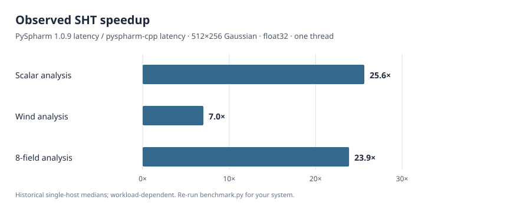

<!-- SPDX-License-Identifier: GPL-2.0-or-later -->

# Benchmarks

The figure compares median elapsed times for three Gaussian-grid operations
at 512 × 256, float32, one DUCC thread, on an AVX2 Linux x86-64 host.
PySpharm 1.0.9 and the multiarch `pyspharm-cpp` 0.1.0 wheel were measured in
the same reference environment (CPython 3.15.0rc2). The original run used
three warmups and ten measured repetitions; neither process isolation nor
CPU affinity was enforced. These are **single-host observations**, not
expected speedups on other systems.



| Operation | PySpharm 1.0.9 | pyspharm-cpp | Direct DUCC 0.42.0 |
| --- | ---: | ---: | ---: |
| Scalar analysis | 28.545 ms | 1.114 ms | 1.105 ms |
| Wind analysis | 20.102 ms | 2.864 ms | 2.690 ms |
| Eight-field scalar analysis | 225.174 ms | 9.432 ms | 9.130 ms |

Lower latency is better. In these cases, `pyspharm-cpp` tracks the direct
DUCC backend closely. This does not imply that all operations or grid sizes
are faster than PySpharm: other measured workloads favored the reference.

## Reproduce

`benchmark.py` measures warmed median and p90 latency, checks representative
outputs, and writes a CSV. Optional PySpharm and `ducc0` installations add
their corresponding measurements. For a PySpharm comparison, use an
environment containing `pyspharm-syl==1.2.1` (PySpharm 1.0.9), the installed
`pyspharm-cpp` wheel, and compatible NumPy.

```sh
DUCC0_NUM_THREADS=1 python benchmarks/benchmark.py \
  --sizes 512x256 --fields 8 --precision float32 \
  --threads 1 --warmups 5 --repeats 25 \
  --output /tmp/pyspharm-benchmark.csv
python benchmarks/plot.py \
  --csv /tmp/pyspharm-benchmark.csv \
  --output benchmarks/speedup.svg
```

Run `python benchmarks/plot.py` without `--csv` to regenerate the
checked-in historical figure from the fixed summary medians in that script.
Results from a new measurement will generally differ. The script uses only
the Python standard library, including for SVG generation.

Different build profiles (`portable`, `native`, `multiarch`), CPU features,
thread counts, and host load can change the results substantially.
The benchmark excludes PySpharm on float64 because its API is float32-only.
Python-traced allocations do not include all native C++ workspaces.

The comprehensive numerical cross-library tests live in
[`tests/parity/`](../tests/parity), separate from performance benchmarks.
